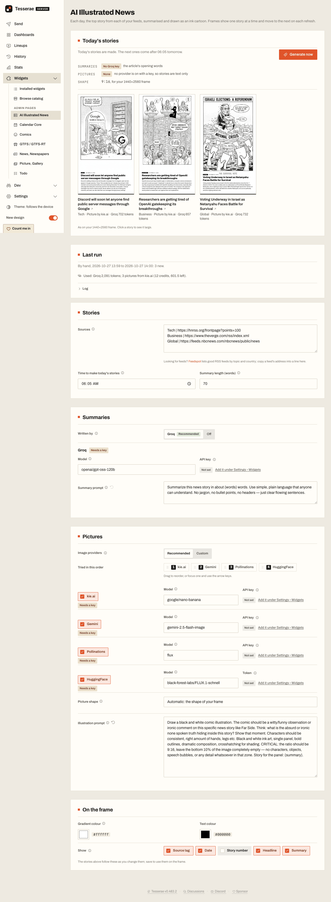

# AI Illustrated News

Once a day, the top story of each of your feeds, summarised by an AI and drawn
as a satirical ink cartoon. The cell shows one story at a time, poster style,
and moves to the next on each refresh.


## What it does

- **Feeds in, stories out.** Add RSS or Atom feeds on the widget's page
  (Widgets, AI Illustrated News), one per line as `Label | feed address`. Each
  feed gives one story a day: its newest.
- **Made in the background.** The day's stories are made on a worker thread at
  the first frame update after the time you choose (06:05 by default), with
  progress in the job tray. A render never waits on it. Generate now and
  Stop are on the page.
- **A summary and a picture per story.** Groq writes a short summary of the
  article; without a Groq key a story shows the article's opening words. The
  picture is drawn by the first image provider in your order that works: kie.ai,
  Gemini, Pollinations or HuggingFace. With no image key, stories are text only.
- **A caption you can style:** which parts show (tag, date, count, headline,
  summary), its colours, and the summary and picture prompts.



## Settings

The API keys are widget settings under Settings > Widgets (stored encrypted).
Everything else is on the widget's own page and kept in `config.json` in the
widget's data folder.

| Key | Used for | Where to get one |
| --- | --- | --- |
| Groq API key | Summaries (optional) | console.groq.com/keys |
| kie.ai API key | Pictures | kie.ai/api-key |
| Gemini API key | Pictures | aistudio.google.com/apikey |
| Pollinations API key | Pictures | enter.pollinations.ai |
| HuggingFace token | Pictures | huggingface.co/settings/tokens |

A provider without a key is skipped. Cell options: show the summary,
show the source and date.

## Needs Tesserae 0.484.1 or newer

Every request goes through the host's `app.net_guard.guarded_opener`, which
connects only to public addresses (feed links come from the open web, so they
can't be trusted to stay off your LAN). That helper is on Tesserae `main` and
ships in the next release; `plugin.json` sets `tesserae_min` to 0.484.1. On an
older host that doesn't read `tesserae_min`, the widget loads, shows "This widget
needs Tesserae 0.484.1 or newer", and makes no requests.

## Network and host helpers

The manifest declares `network:*`: the feeds are yours, the article pages come
from them, and the four image providers and Groq are fixed hosts. It uses
`app.net_guard` (above), `app.jobs` for the job tray (optional) and
`app.tz_resolve` for the time zone (optional). Nothing else from the host
beyond the plugin contract.

## Tests

The tests run against a checkout of Tesserae `main`. Copy this folder in as
`plugins/news_illustrated` (a copy, not a symlink: the widget takes its id
from its folder name) and run from the checkout root:

```sh
python -m pytest plugins/news_illustrated/tests
```

No test touches the network. The browser tests need Playwright's Chromium and
skip themselves without it; the client check needs `node`.

## History

This widget is a rewrite of the `ainews` module of my own earlier PHP app,
[visionect-display-manager](https://github.com/skynet01/visionect-display-manager)
(GPL-3.0, same author). Nothing from anyone else's project is in it.

## Licence

AGPL-3.0, see [LICENSE](LICENSE).
